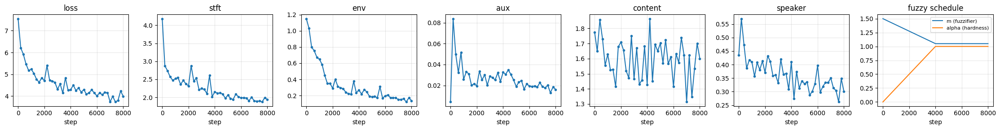
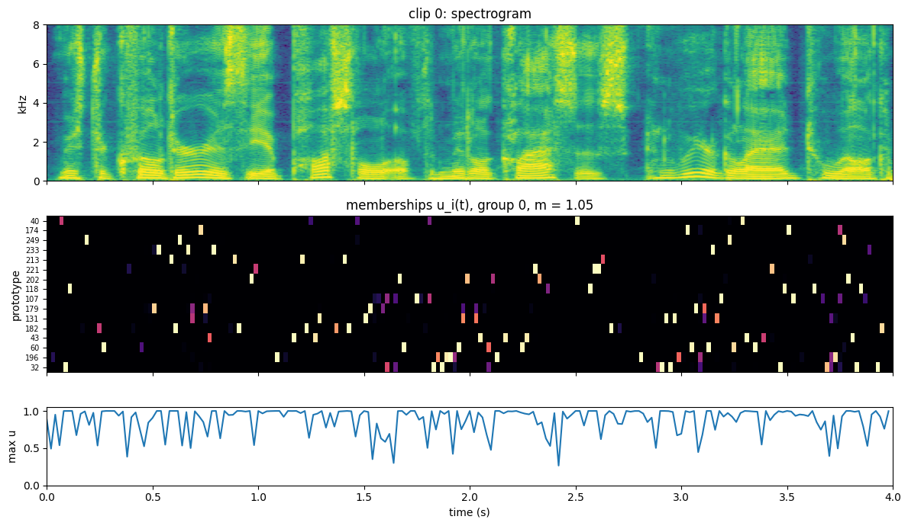
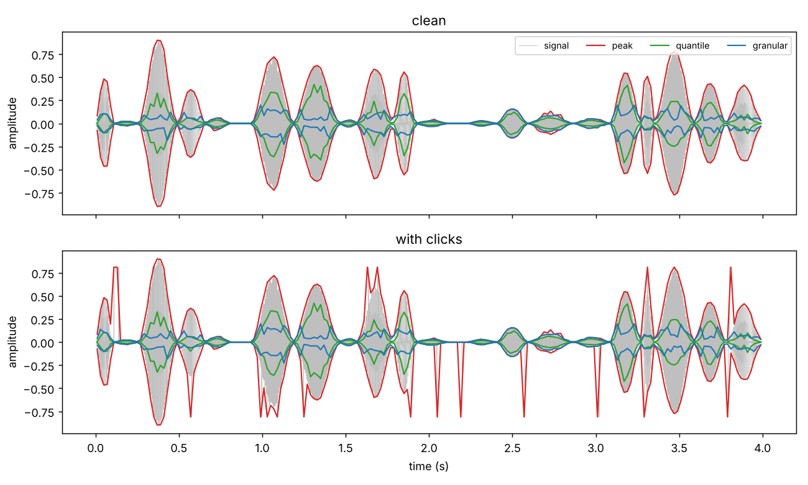

# Granular speech codec

An end-to-end speech codec trained with perceptual priors, used to compare
three ways of quantizing the latent code at the same rate:

| Quantizer | How a frame is coded | Gradient through the quantizer |
|---|---|---|
| `fsq` | each dim rounded to one of L levels (finite scalar quantization) | straight-through |
| `vq` | nearest prototype in a learned codebook (VQ-VAE) | straight-through |
| `fuzzy` | fuzzy c-means memberships over prototypes, decoded by c-means degranulation; hardened during training | through the soft memberships, no straight-through |

The codec body (encoder, decoder, losses) is the same for all three, so any
difference comes from the quantizer.

## The granular reading

| Codec part | Granular computing term |
|---|---|
| encoder + memberships $u_i$ | granulation: a frame becomes degrees of membership to $K$ prototypes |
| decoder input $\hat{x} = \sum_i u_i^m v_i \big/ \sum_i u_i^m$ | degranulation (c-means reconstruction) |
| codebook size $K$ | granularity (number of granules) |
| c-means objective $J = \sum_i u_i^m D_i$ | the granulation criterion, used as the quantizer's training loss |
| content prior: CTC posteriors per frame | a membership vector over characters; the codec must keep it (KL) |
| speaker prior: speaker embedding | the codec must keep the speaker (cosine) |
| `envelope_experiment.py` | interval-valued envelope from the principle of justifiable granularity |

For one frame vector $x$ and prototypes $v_1, \dots, v_K$, with distances
$d_i = \lVert x - v_i \rVert$, squared distances $D_i = d_i^2$ and fuzzifier
$m > 1$, the memberships are

```math
u_i \;=\; \frac{1}{\sum_{j=1}^{K} \left( d_i / d_j \right)^{2/(m-1)}}
\;=\; \operatorname{softmax}_i\!\left( -\frac{\log D_i}{m-1} \right),
\qquad \sum_{i=1}^{K} u_i = 1 .
```

and degranulation rebuilds the frame as

```math
\hat{x} \;=\; \frac{\sum_{i=1}^{K} u_i^{m}\, v_i}{\sum_{i=1}^{K} u_i^{m}} .
```

As $m \to 1$ the exponent $2/(m-1) \to \infty$, so the memberships become
one-hot at the nearest prototype, which is plain VQ. During training $m$ goes
from 1.5 to 1.05, and the forward value moves from the soft reconstruction to
the hard prototype as $\alpha$ (`alpha`) goes from 0 to 1. The
gradient always comes from the soft path. At test time only the index is sent
and the decoder gets the hard prototype.

Related work to cite and compare with: soft-to-hard vector quantization
(Agustsson et al., 2017), VQ-VAE (van den Oord et al., 2017), finite scalar
quantization (Mentzer et al., 2023). The fuzzy quantizer is close to the
soft-to-hard idea; the new part here is the c-means formulation and the
comparison, not soft quantization itself.

## What changed from the 2018 draft

- **Quantizer gradient.** The draft review asked whether the derivative
  exists through the quantizer. Here the fuzzy quantizer is differentiable by
  construction, and the two baselines use straight-through.
- **Envelope.** The Hilbert envelope on raw speech follows the glottal pulses
  (draft Fig. 7). The envelope term now uses the smoothed log-energy
  (draft Fig. 8), which is differentiable.
- **Priors.** Content prior = frame-level KL between CTC posteriors of the
  original and decoded speech (draft Eq. 1). Speaker prior = cosine distance
  of speaker embeddings, because a speaker classifier over a fixed set of
  speakers does not cover new speakers.
- **Curriculum.** `--content_start` and `--speaker_start` turn the priors on
  later, as in the draft's training procedure (section 3.4).
- **Not included yet:** the latent predictor `f_p` and a real entropy coder.
  The rate is measured as the empirical entropy of the indices, which is what
  an ideal entropy coder without context would reach.

## Files

    gsc/quantizers.py      FSQ, VQ, FuzzyVQ
    gsc/model.py           encoder/decoder (50 frames/s at 16 kHz)
    gsc/losses.py          multi-resolution STFT, log-energy envelope
    gsc/priors.py          wav2vec 2.0 CTC (content), WavLM x-vector (speaker), WER
    gsc/rate.py            entropy rate of the indices
    gsc/evaluation.py      rate and quality metrics, saves audio samples
    gsc/envelope.py        peak, quantile and justifiable-granularity envelopes
    train.py               one run
    sweep.sh               3 quantizers x 4 codebook sizes
    plot_results.py        quality vs entropy rate
    envelope_experiment.py click robustness of the three envelopes
    tests/test_smoke.py    CPU checks, no downloads
    notebooks/             Kaggle notebooks: setup + inspection, overnight comparison
    docs/figures/          figures from the first runs

## Running on Kaggle

1. New notebook, accelerator GPU (T4 or P100), Internet on.
2. Get the code (upload this folder as a Kaggle dataset, or clone it after
   you push it to GitHub) and install:

        !pip install -q -r requirements.txt
        !python -m pytest -q tests

3. Get LibriSpeech from OpenSLR (dev-clean is about 340 MB, train-clean-100
   about 6 GB; check the sizes on the site):

        !wget -q https://www.openslr.org/resources/12/dev-clean.tar.gz
        !wget -q https://www.openslr.org/resources/12/train-clean-100.tar.gz
        !tar xzf dev-clean.tar.gz && tar xzf train-clean-100.tar.gz

4. Start with one run and time it:

        !python train.py --data_dir LibriSpeech/train-clean-100 \
            --eval_dir LibriSpeech/dev-clean --quantizer fuzzy \
            --steps 20000 --w_content 1 --w_speaker 1 --out runs/fuzzy_256

   Look at the seconds per step in the log before planning the sweep. A
   Kaggle session stops after about 12 hours, so long sweeps need several
   sessions; copy `runs/` to the output between sessions.

5. Envelope experiment (no GPU needed):

        !python envelope_experiment.py --data_dir LibriSpeech/dev-clean

## What to check in a run

- `codes_used` in the eval line. If a group uses only a few of its K codes,
  the codebook has collapsed and the rate comparison is not fair.
- `entropy_bps` vs `nominal_bps`. Compare methods at matched entropy rate.
- Listen to `runs/*/samples_*/`.
- The fuzzy loss term `aux` and the `m`, `alpha` columns, to see the
  hardening.

## Results so far (first runs, November 2026)

These are single runs with one random seed, so treat them as first
observations, not final numbers.

### 1. With perceptual priors on from the start

Training on LibriSpeech train-clean-100, 8,000 steps, batch 16, 1 s clips,
all five loss terms with weight 1. Test: 100 clips of 4 s from dev-clean.
All three codecs have the same nominal rate, 1,600 bit/s
(4 groups x 256 codes x 50 frames/s).

| | Fuzzy | VQ | FSQ |
|---|---|---|---|
| Codes used per group (of 256) | 209, 183, 210, 191 | 3, 3, 3, 3 | 1, 1, 1, 1 |
| Measured (entropy) rate, bit/s | **1,097** | 18 | 0 |
| Log-spectral distance, dB | **18.1** | 24.6 | 24.6 |
| Envelope error (x 10 dB) | **0.12** | 1.19 | 1.19 |
| Speaker similarity (cosine) | **0.71** | 0.51 | 0.56 |
| WER vs original transcript | 1.02 | 1.00 | 1.00 |

VQ and FSQ collapsed: they send (almost) the same code for every frame, so
their decoders output the same sound whatever the input. Their numbers are
therefore the floor of each metric (about 24.6 dB, speaker cosine about 0.55).
The fuzzy quantizer kept most of its codebook in use and transmitted about
1.1 kbit/s.

What the fuzzy codec learned in 8,000 steps: the loudness over time (envelope
error fell from about 11 dB to about 1 dB) and, in part, the voice (speaker
cosine 0.57 to 0.71). What it did not learn: harmonics and formants. The
decoded spectrogram has no pitch lines, the content loss stayed flat, and no
words survive (WER about 1).





### 2. Control: the same baselines without the perceptual priors

Training on dev-clean (98 %, test on the other 2 %), 2,000 steps, spectrum and
envelope losses only.

| | Step 1,000 | Step 2,000 |
|---|---|---|
| VQ codes used | 171, 167, 202, 168 | 150, 148, 201, 130 |
| VQ rate, bit/s | 1,033 | 1,052 |
| FSQ codes used | 1, 1, 1, 1 | 1, 1, 1, 1 |

- **VQ trains normally without the priors.** So its collapse in run 1 is tied
  to the perceptual losses. One hypothesis, not yet tested: with the priors on
  from step 1, a constant output is a comfortable minimum (the collapsed
  models scored a lower content KL, about 1.78, than the fuzzy codec, about
  2.5), and the soft start of the fuzzy quantizer lets its encoder learn the
  waveform losses before the codes become hard.
- **FSQ collapses even without the priors, so the FSQ baseline is not fair
  yet.** Tracing its values shows the encoder output jumping in the first
  steps and then shrinking into the middle rounding level, after which every
  frame gets the same code and the decoder ignores it. The configuration used
  here (4 levels on each of 4 dimensions, no learning-rate warmup) differs
  from the level choices recommended for FSQ; fixing it is the next step.

### Next

- FSQ with recommended levels and a learning-rate warmup.
- Priors switched on later (`--content_start`, `--speaker_start`) for all
  quantizers, to test the hypothesis above.
- Several seeds, a test set spread over all dev-clean speakers, and longer
  training for intelligibility.

## Envelope experiment

The envelope experiment on synthetic signals (40 clips, 20 clicks each;
distortion = change in the envelope caused by the clicks, relative to the
envelope width):

| Envelope | Click distortion | Coverage of clean samples | Width vs peak |
|---|---|---|---|
| peak | 0.199 | 1.00 | 1.00 |
| quantile (5 %, 95 %) | 0.004 | 0.90 | 0.31 |
| granular | 0.057 | 0.96 | 0.31 |

On these signals the granular envelope resists clicks much better than the
peak envelope but less well than a fixed quantile, and in loud voiced parts
it sits well inside the peaks. This needs checking on real speech before any
claim is made.



