# Granular speech codec

An end-to-end speech codec trained with perceptual priors, used to compare
three ways of quantizing the latent code at the same rate:

| Quantizer | How a frame is coded | Gradient through the quantizer |
|---|---|---|
| `fsq` | each dim rounded to one of L levels (finite scalar quantization) | straight-through |
| `vq` | nearest prototype in a learned codebook (VQ-VAE) | straight-through |
| `fuzzy` | fuzzy c-means memberships over prototypes, decoded by c-means degranulation; hardened during training | through the soft memberships, no straight-through |

The codec body (encoder, decoder, losses) is the same for all three, so any
difference comes from the quantizer.

## Key findings so far

Two training runs on LibriSpeech (8,000 steps each), plus a short control, at
a nominal 1.6 kbit/s. Single runs per setting, so these are first
observations, not final numbers.

1. **With the perceptual priors on from the first step, standard VQ collapses,
   and the fuzzy c-means quantizer does not.** VQ ended with 3 codes per group
   (18 bit/s) in two runs with different seeds; the fuzzy quantizer kept about
   200 of its 256 codes in use (1.1 kbit/s).
2. **If the priors start halfway through training, VQ trains well and is
   slightly better than the fuzzy quantizer at the same measured rate** (about
   1.2 kbit/s): spectral distance 16.1 vs 17.2 dB, speaker similarity 0.86 vs
   0.81, word error rate 0.62 vs 0.87. So in this setup the c-means path buys
   robustness, not quality. The fuzzy codec lags already at step 2,000,
   before any prior is on, which points at its soft-to-hard schedule (see
   [What the results mean](#what-the-results-mean)).
3. **FSQ needed an input normalization to work at all.** With it, FSQ is the
   best codec here, at a higher measured rate (1.40 kbit/s).
4. **Speech starts to become intelligible.** Word error rates against the
   original's transcript fell from 1.0 to 0.59 to 0.87.
5. **The justifiable-granularity envelope is robust on real speech**: clicks
   move it 13 times less than the peak envelope, and it covers 98 % of the
   samples. A fixed 5 %–95 % quantile is more robust still, but covers 91 %.

## The granular reading

| Codec part | Granular computing term |
|---|---|
| encoder + memberships $u_i$ | granulation: a frame becomes degrees of membership to $K$ prototypes |
| decoder input $\hat{x} = \sum_i u_i^m v_i \big/ \sum_i u_i^m$ | degranulation (c-means reconstruction) |
| codebook size $K$ | granularity (number of granules) |
| c-means objective $J = \sum_i u_i^m D_i$ | the granulation criterion, used as the quantizer's training loss |
| content prior: CTC posteriors per frame | a membership vector over characters; the codec must keep it (KL) |
| speaker prior: speaker embedding | the codec must keep the speaker (cosine) |
| `envelope_experiment.py` | interval-valued envelope from the principle of justifiable granularity |

For one frame vector $x$ and prototypes $v_1, \dots, v_K$, with distances
$d_i = \lVert x - v_i \rVert$, squared distances $D_i = d_i^2$ and fuzzifier
$m > 1$, the memberships are

```math
u_i \;=\; \frac{1}{\sum_{j=1}^{K} \left( d_i / d_j \right)^{2/(m-1)}}
\;=\; \operatorname{softmax}_i\!\left( -\frac{\log D_i}{m-1} \right),
\qquad \sum_{i=1}^{K} u_i = 1 .
```

and degranulation rebuilds the frame as

```math
\hat{x} \;=\; \frac{\sum_{i=1}^{K} u_i^{m}\, v_i}{\sum_{i=1}^{K} u_i^{m}} .
```

As $m \to 1$ the exponent $2/(m-1) \to \infty$, so the memberships become
one-hot at the nearest prototype, which is plain VQ. During training $m$ goes
from 1.5 to 1.05, and the forward value moves from the soft reconstruction to
the hard prototype as $\alpha$ (`alpha`) goes from 0 to 1. The
gradient always comes from the soft path. At test time only the index is sent
and the decoder gets the hard prototype.

Related work to cite and compare with: soft-to-hard vector quantization
(Agustsson et al., 2017), VQ-VAE (van den Oord et al., 2017), finite scalar
quantization (Mentzer et al., 2023). The fuzzy quantizer is close to the
soft-to-hard idea; the new part here is the c-means formulation and the
comparison, not soft quantization itself.

## Results

### Setup shared by all runs

- **Data:** LibriSpeech train-clean-100 for training (random 1 s clips, batch
  16); 100 clips of 4 s from dev-clean for testing (spread over its speakers in
  run 2; the first 100 files in run 1).
- **Codec:** 16 kHz, 50 frames/s, 4 groups x 256 codes = 32 bits per frame =
  1,600 bit/s nominal (FSQ in run 2: 4 x 240 codes, 1,581 bit/s).
- **Losses:** multi-resolution spectrum, log-energy envelope, the quantizer's
  own loss, content prior (KL between wav2vec 2.0 character posteriors) and
  speaker prior (WavLM embedding cosine), all with weight 1.
- **Metrics:** measured rate = entropy of the sent indices; log-spectral
  distance (LSD, dB); speaker similarity (cosine, 1 = same voice); word error
  rate of the decoded speech against the recognizer's transcript of the
  original (so it counts what the codec destroys, not recognizer mistakes).

### Run 1: priors on from the first step

[notebook](notebooks/overnight_fuzzy_vq_fsq.ipynb)

| | Fuzzy | VQ | FSQ (first version) |
|---|---|---|---|
| Codes used per group (of 256) | 209, 183, 210, 191 | 3, 3, 3, 3 | 1, 1, 1, 1 |
| Measured rate, bit/s | **1,097** | 18 | 0 |
| Log-spectral distance, dB | **18.1** | 24.6 | 24.6 |
| Envelope error (x 10 dB) | **0.12** | 1.19 | 1.19 |
| Speaker similarity | **0.71** | 0.51 | 0.56 |
| WER vs original | 1.02 | 1.00 | 1.00 |

VQ and FSQ sent (almost) the same code for every frame, so their decoders
produced the same sound whatever the input. Their numbers are the floor of
each metric: about 24.6 dB and a speaker similarity of about 0.55 for
sending nothing.

<details><summary>Run 1 figures (fuzzy codec)</summary>


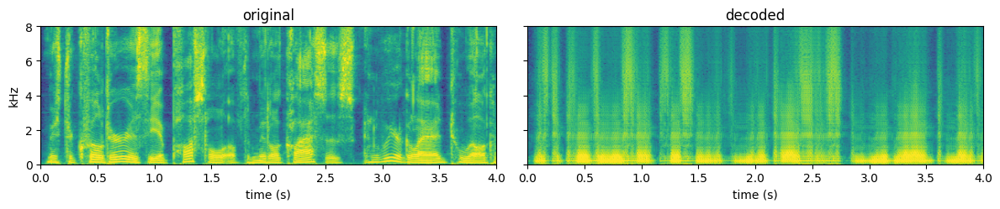


</details>

### Control: no perceptual priors (2,000 steps on dev-clean)

| | Step 1,000 | Step 2,000 |
|---|---|---|
| VQ codes used | 171, 167, 202, 168 | 150, 148, 201, 130 |
| VQ rate, bit/s | 1,033 | 1,052 |
| FSQ (first version) codes used | 1, 1, 1, 1 | 1, 1, 1, 1 |

VQ trains normally without the priors, so its collapse in run 1 is tied to
them. FSQ collapsed even here: tracing its values showed the encoder output
shrinking into the middle rounding level within 50 steps, after which every
frame got the same code. Fix used in run 2: a BatchNorm layer before the
rounding, levels (8, 6, 5) per group, and a 500-step learning-rate warmup.

### Run 2: priors switched on at step 4,000

[notebook with all outputs](notebooks/run2_results.ipynb) ·
[raw logs](results/run2/)

Runs 1 to 3 use a 500-step warmup and turn the priors on at step 4,000. The
last run repeats run 1's VQ setting (priors from step 1, no warmup) with a
new seed.

| | VQ | Fuzzy | FSQ (fixed) | VQ, priors from step 1, seed 1 |
|---|---|---|---|---|
| Steps | 8,000 | 8,000 | 8,000 | 4,000 |
| Codes used per group | 206, 202, 242, 220 (of 256) | 198, 218, 190, 200 (of 256) | 234, 240, 240, 237 (of 240) | 3, 3, 3, 3 |
| Measured rate, bit/s | 1,192 | 1,202 | 1,403 | 18 |
| Log-spectral distance, dB | 16.1 | 17.2 | **15.8** | 25.7 |
| Envelope error (x 10 dB) | 0.092 | 0.091 | **0.083** | 1.14 |
| Speaker similarity | **0.86** | 0.81 | 0.85 | 0.49 |
| Content KL (nats) | 1.79 | 2.12 | **1.70** | 1.94 |
| WER vs original | 0.62 | 0.87 | **0.59** | 1.00 |

Test metrics over training (dashed line: priors switched on):

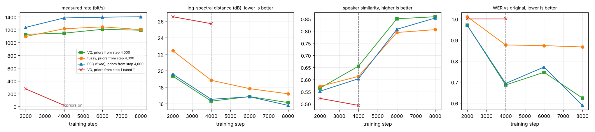

Final quality against measured rate:

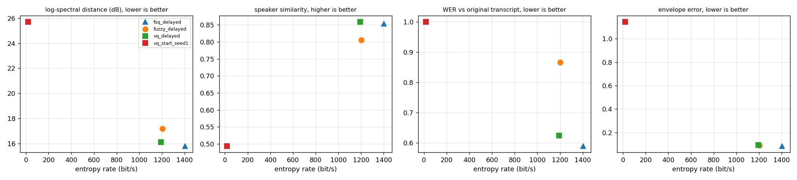

### Inside the fuzzy codec (run 2, step 8,000)

**Transcripts.** The recognizer's reading of the original and of the decoded
speech, for three test clips:

| Original | Decoded (fuzzy codec) | WER |
|---|---|---|
| MISTER QUILTER IS THE APOSTLE OF THE MIDDLE CLASSES AND WE ARE GLAD TO WELK | CEADER AS THE OPPRESSOR OF THE MIDELASSES WORD LAND TO OUT | 0.73 |
| I'LL BE LUCKY IF I HAVE TIME TO BREATHE | I DO LETY IF I HAVE TIME TO BREATHE | 0.33 |
| LONELY AND SO SOLEMN WITH THE SAD GRAY CLOUDS ABOVE AND NO SOU | HIHIM TO SORROW TIT THE SAD PA TMOUT TO POUT AND NO SOU | 0.69 |

**Listen** (4 s clips, 16 kHz WAV; GitHub offers them as downloads):

| Clip | Original | VQ | Fuzzy | FSQ | VQ collapsed (priors from step 1) |
|---|---|---|---|---|---|
| 0 | [wav](docs/audio/clip00_original.wav) | [wav](docs/audio/clip00_vq.wav) | [wav](docs/audio/clip00_fuzzy.wav) | [wav](docs/audio/clip00_fsq.wav) | [wav](docs/audio/clip00_vq_collapsed.wav) |
| 1 | [wav](docs/audio/clip01_original.wav) | [wav](docs/audio/clip01_vq.wav) | [wav](docs/audio/clip01_fuzzy.wav) | [wav](docs/audio/clip01_fsq.wav) | [wav](docs/audio/clip01_vq_collapsed.wav) |

**Spectrograms.** The decoded speech keeps the timing and the broad spectral
shape, but the pitch harmonics are mostly gone:

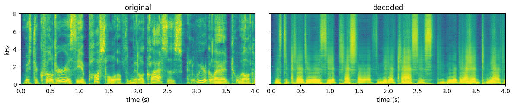

**What the recognizer hears.** Character probabilities every 20 ms for the
original (top) and the decoded speech (middle), and their KL divergence
(bottom). Many characters survive; the KL spikes where they do not:

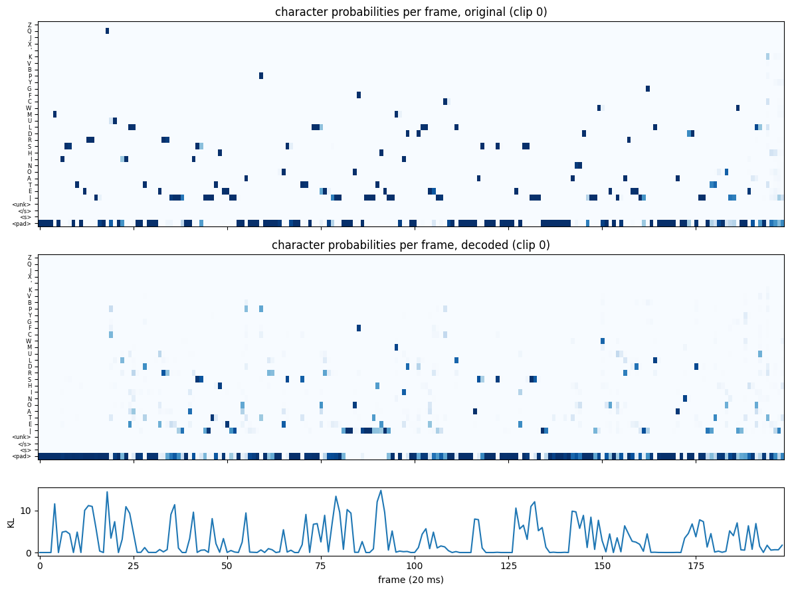

**Granules over time.** Memberships of the 16 most active prototypes in group
0, under the spectrogram. Most frames sit clearly in one granule (largest
membership near 1); the dips are frames between granules:

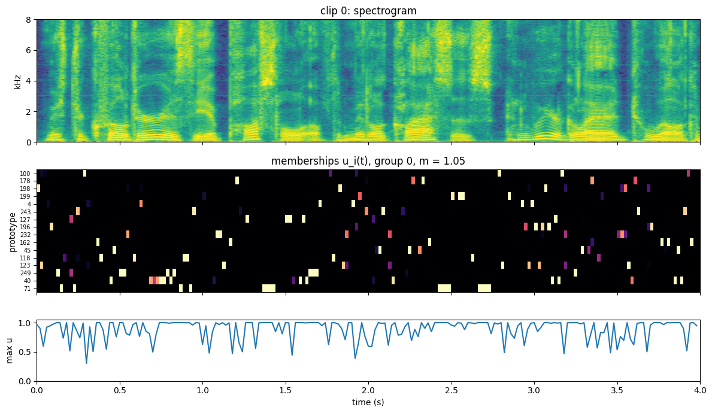

**The fuzzifier.** For one frame, the largest memberships at several values of
$m$ (left), and the latent reconstruction error of soft degranulation against
the hard prototype (right). As $m \to 1$ the soft reconstruction becomes the
hard one, which is why training lowers $m$:

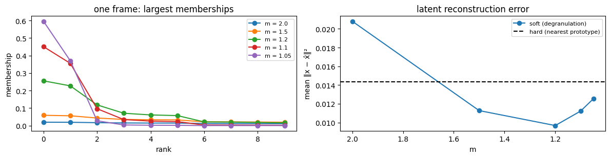

**Codebook.** Code usage per group, and the frames and prototypes of group 0
projected on their two main directions (PCA):

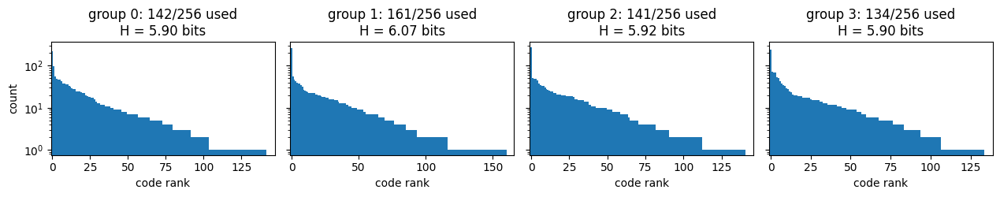
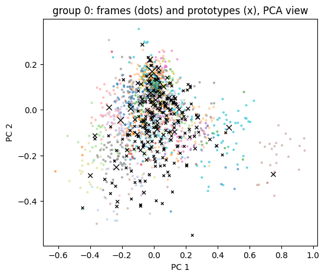

<details><summary>Training curves of the fuzzy run</summary>

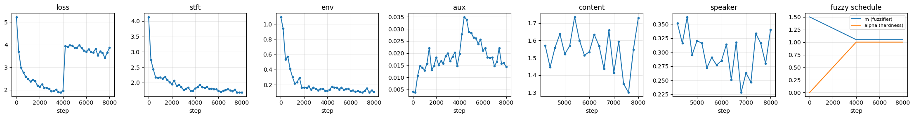

</details>

### Envelope experiment: justifiable granularity on real speech

Each 20 ms window of the signal gets an interval $[a, b]$ around its median.
Three ways to choose it: the window's min and max (peak), its 5 % and 95 %
quantiles, or the principle of justifiable granularity (maximize
coverage x specificity, with $\text{specificity}(b) = 1 - (b - \text{med})/R$).
Then 20 single-sample clicks are added to each clip, and the change of the
envelope is measured, relative to its width.

| Envelope | Click distortion (speech) | Coverage (speech) | Width vs peak (speech) | Click distortion (synthetic) |
|---|---|---|---|---|
| peak | 0.181 | 1.00 | 1.00 | 0.199 |
| quantile 5 %–95 % | **0.0009** | 0.91 | 0.68 | 0.004 |
| justifiable granularity | 0.014 | **0.98** | 0.76 | 0.057 |

(200 dev-clean clips of 4 s; 40 synthetic clips.) The granular envelope
ignores almost all clicks (13 times less change than the peak envelope)
while still covering 98 % of the samples; the fixed quantile is more robust
but, by design, leaves 9 % of the samples outside. Unlike the quantile, the
granular bound adapts its coverage to each window.

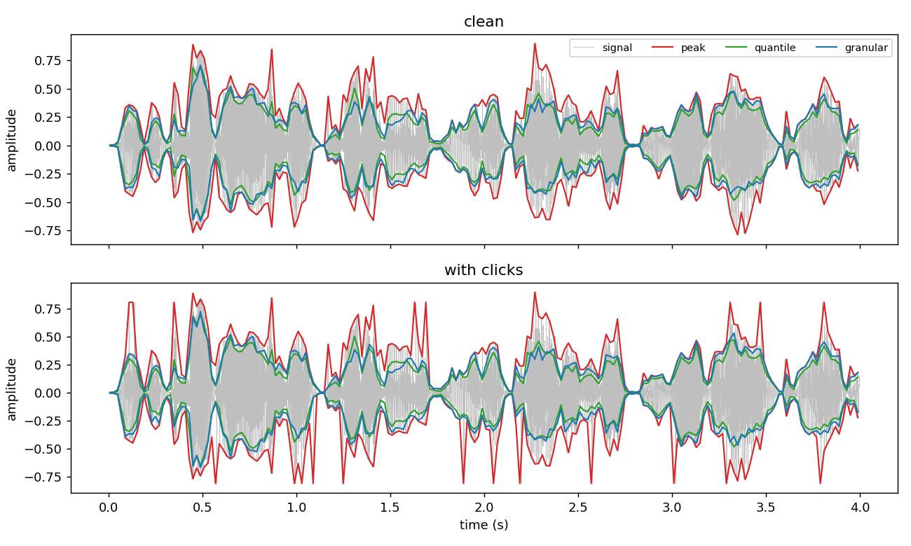

How one bound is chosen (left), the chosen interval on that window's samples
(middle), and the three envelopes over a clip (right):

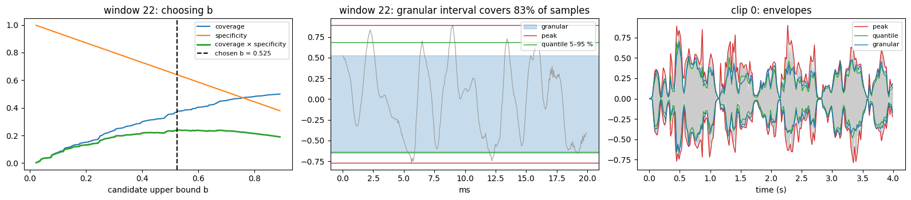

### What the results mean

- **Robustness.** The collapse of VQ under perceptual priors from step 1 is
  repeatable (two seeds), and the fuzzy quantizer avoids it. A likely reason:
  a constant output is a comfortable minimum for the content prior (the
  collapsed models score a lower content KL than the working fuzzy codec),
  and the straight-through gradient gives the encoder little reason to leave
  it, while the soft c-means path starts with useful gradients.
- **Quality.** With a curriculum, the standard quantizers do better. The fuzzy
  codec is behind from the first evaluation (step 2,000, LSD 22.4 dB vs
  19.3 dB for VQ), before any prior is on. Up to step 4,000 its decoder
  receives a changing mix of soft and hard prototypes ($\alpha < 1$, $m > 1.05$),
  while the VQ decoder always receives hard ones; this schedule is the first
  suspect.
- **Not yet known:** whether the robustness comes from the c-means form or
  only from starting soft (see next steps), and how much of FSQ's lead comes
  from its higher rate.

## Next steps

1. **Ablation of the membership form.** Replace the c-means memberships with a
   Gaussian-style softmax of $-D_i / T$ (soft-to-hard VQ) and train with the
   priors from step 1. If it also survives, the robustness comes from the soft
   start; if not, from the c-means form (scale-free, power-law memberships).
2. **Close the quality gap.** Faster hardening (`--anneal_frac 0.25`), a lower
   final fuzzifier, or a smaller weight on the c-means objective.
3. **Matched rates.** Sweep the codebook size so all quantizers are compared at
   the same measured rate (FSQ ran at 1.40 kbit/s, the others at 1.20).
4. **Several seeds per setting,** and longer training for intelligibility.
5. **Use the memberships at inference.** The largest membership of a frame is
   a per-frame confidence; it could decide where to spend more bits
   (allocation of granularity).

## What changed from the 2018 draft

- **Quantizer gradient.** The draft review asked whether the derivative
  exists through the quantizer. Here the fuzzy quantizer is differentiable by
  construction, and the two baselines use straight-through.
- **Envelope.** The Hilbert envelope on raw speech follows the glottal pulses
  (draft Fig. 7). The envelope term now uses the smoothed log-energy
  (draft Fig. 8), which is differentiable.
- **Priors.** Content prior = frame-level KL between CTC posteriors of the
  original and decoded speech (draft Eq. 1). Speaker prior = cosine distance
  of speaker embeddings, because a speaker classifier over a fixed set of
  speakers does not cover new speakers.
- **Curriculum.** `--content_start` and `--speaker_start` turn the priors on
  later, as in the draft's training procedure (section 3.4).
- **Not included yet:** the latent predictor `f_p` and a real entropy coder.
  The rate is measured as the empirical entropy of the indices, which is what
  an ideal entropy coder without context would reach.

## Files

    gsc/quantizers.py      FSQ, VQ, FuzzyVQ
    gsc/model.py           encoder/decoder (50 frames/s at 16 kHz)
    gsc/losses.py          multi-resolution STFT, log-energy envelope
    gsc/priors.py          wav2vec 2.0 CTC (content), WavLM x-vector (speaker), WER
    gsc/rate.py            entropy rate of the indices
    gsc/evaluation.py      rate and quality metrics, saves audio samples
    gsc/envelope.py        peak, quantile and justifiable-granularity envelopes
    train.py               one run
    sweep.sh               3 quantizers x 4 codebook sizes
    plot_results.py        quality vs entropy rate
    envelope_experiment.py click robustness of the three envelopes
    tests/test_smoke.py    CPU checks, no downloads
    notebooks/
      granular_codec_kaggle.ipynb    setup + step-by-step inspection of a run
      overnight_fuzzy_vq_fsq.ipynb   run 1
      librispeech_prep_cpu.ipynb     downloads and checks LibriSpeech (CPU only)
      run2_delayed_priors_gpu.ipynb  run 2 (template)
      run2_results.ipynb             run 2 with all outputs
    results/run2/          raw logs: args, training log, evaluations, envelope numbers
    docs/figures/          figures of run 1 and run 2
    docs/audio/            original and decoded test clips

## Running on Kaggle

1. Run `notebooks/librispeech_prep_cpu.ipynb` once in a CPU-only notebook
   (Internet on, Save & Run All). Its output keeps the two verified LibriSpeech
   archives, and it uses no GPU time.
2. In a GPU notebook (Internet on), add that notebook's output as an input and
   run `notebooks/run2_delayed_priors_gpu.ipynb`. It clones this repo, unpacks
   the data, and trains; a training step takes about 0.37 s without the priors
   and about 1.05 s with them on a Kaggle GPU.
3. To inspect a run step by step (audio players, memberships, priors,
   envelopes), use the Part 2 cells of `notebooks/granular_codec_kaggle.ipynb`
   with `RUN` set to the run folder.

Single runs from the command line:

    python train.py --data_dir LibriSpeech/train-clean-100 \
        --eval_dir LibriSpeech/dev-clean --quantizer fuzzy --steps 8000 \
        --warmup 500 --w_content 1 --w_speaker 1 \
        --content_start 4000 --speaker_start 4000 --out runs/fuzzy

## What to check in a run

- `codes_used` in the eval line. If a group uses only a few of its K codes,
  the codebook has collapsed and the rate comparison is not fair.
- `entropy_bps` vs `nominal_bps`. Compare methods at matched entropy rate.
- Listen to `runs/*/samples_*/`.
- The fuzzy loss term `aux` and the `m`, `alpha` columns, to see the
  hardening.
